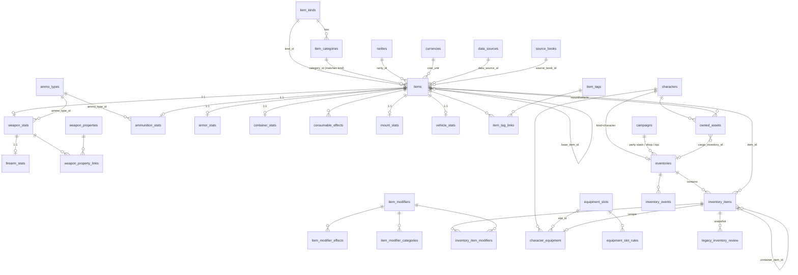

# Inventory database

Status: **tested on a local Supabase stack (Supabase CLI 2.118.0, Postgres 17.6, GoTrue, PostgREST, Realtime, Storage) and on
plain PostgreSQL 15. Never applied to a remote project.** The Inventory tab uses the new model (docs/INVENTORY_UI.md); other parts of the app are unaffected because every change
to `inventory_items` is additive.

Related: [model](../data/reports/master_item_model.md) · [migration review](MIGRATION_REVIEW.md) · [RLS review](RLS_SECURITY_REVIEW.md) ·
[scope review](DATABASE_SCOPE_REVIEW.md) · [indexes](INDEX_STRATEGY.md) · [equipment transition](EQUIPMENT_TRANSITION.md) ·
[legacy inventory](LEGACY_INVENTORY_MIGRATION.md) · [containers](CONTAINER_MODEL.md) · [consumables](CONSUMABLE_EFFECTS.md) ·
[data pipeline](../scripts/data-migration/README.md)

## Files

| File | Contents |
|---|---|
| `supabase/config.toml` | local Supabase CLI config (`supabase init`; seed path set to `./seed/reference_data.sql`). Not linked to any project. |
| `supabase/schema.sql` | base schema as applied by hand on the live project (unchanged) |
| `supabase/migrations/20261015000000_base_schema.sql` | generated copy of `schema.sql` (baseline for new projects) |
| `…0100_item_lookups` · `…0200_item_catalog` · `…0300_item_typed_stats` · `…0400_item_modifiers_and_tags` | catalog |
| `…0500_inventories` · `…0600_equipment` | inventories, events, owned assets, legacy snapshot, equipment |
| `…0700_inventory_functions` · `…0800_inventory_views` · `…0900_inventory_rls` · `…1000_inventory_indexes` | RPCs, views, RLS, indexes |
| `…1100_legacy_inventory_migration` | `migrate_legacy_inventory()` |
| `…1200_inventory_frontend_rpcs` | `set_inventory_item_quantity`, `move_inventory_item`, `link_inventory_item` (needed by the inventory UI) |
| `supabase/seed/reference_data.sql` | **generated**, idempotent reference seed (1146 items) |
| `supabase/rollback/rollback_inventory.sql` | reverses the inventory migrations |
| `supabase/tests/` | plain-PostgreSQL runner, Supabase runner, SQL tests, API contract tests, fixtures |

## Object counts (measured)

| | Added by the inventory migrations | Total in `public` |
|---|---|---|
| Tables | 34 | 45 (RLS on all) |
| Views | 7 (all `security_invoker`) | 7 |
| Functions | 43 (13 RPCs, 12 permission helpers, 18 internal/trigger) | 54 |
| RLS policies | 42 | 61 |
| Indexes (incl. PK / unique) | 52 (11 explicit) | 75 |
| Triggers | 10 | 15 |

## Entity relationships



## RPCs (SECURITY DEFINER, authenticated only, one transaction each)

`add_inventory_item` · `remove_inventory_item` · `split_inventory_stack` · `merge_inventory_stacks` · `equip_item` ·
`unequip_item` · `attune_item` · `unattune_item` · `use_inventory_item` · `transfer_inventory_item` ·
`set_inventory_item_quantity` · `move_inventory_item` · `link_inventory_item`.
Admin-only (not callable by clients): `migrate_legacy_inventory()`. Details: RLS review, equipment transition, consumables.

## Compatibility with the current frontend

- `select *` by `character_id` and the realtime filter still work (`character_id` is kept, derived from `inventory_id`).
- "+ Add item" and the JSON import insert the same columns as before.
- `equipped` is a read-only projection of `character_equipment`: the checkbox no longer persists.
- Quantity 0 can no longer be saved (new writes must be ≥ 1).
- The catalog (1146 rows) is larger than PostgREST's `max_rows` (1000): a catalog fetch must paginate (`Range` header).

## Running the tests

```
python scripts/db/sync_base_migration.py --check     # baseline == schema.sql
bash supabase/tests/run_local.sh                     # plain PostgreSQL 15 container (fast, Auth/PostgREST simulated)
SUPABASE_CLI=<path to supabase CLI> bash supabase/tests/run_supabase_local.sh   # real local Supabase stack
```

`run_supabase_local.sh` refuses to run if the checkout is linked to a remote project, uses only `--local` commands, starts
from an empty local volume, and ends with `supabase stop --no-backup` (only this project's containers). The local API keys are
read at runtime from `supabase status`; they are the well-known local development keys and are never written to the repository.

## Applying to a real project (NOT done; needs approval)

See the rollout order in [MIGRATION_REVIEW.md](MIGRATION_REVIEW.md). Before that: confirm the hosted project's Postgres major
version (`config.toml` uses 17; the plain test uses 15) and take a backup.

## Rollback

`supabase/rollback/rollback_inventory.sql` (destructive for new-model data; keeps legacy character rows and restores their
`equipped` values and the original policy/grants). Locally, `supabase db reset --local` is simpler. Both are tested.

## Known limitations

- Hoopak has no ammunition type; basic ammunition has no price/weight; magic weapons/armor have no stats/category; `base_item_id` is null (57 candidates listed in `unresolved_items.json`).
- Only the Potion of Healing family has structured effects; only gear containers and the Bag of Holding have capacity data.
- Wondrous items may use every body slot (the data does not say where they are worn). Magic armor without a category fits the armor slot through 46 item-level rules (a kind-level rule would also let shields in).
- No economy: players may add any catalog item, modifier or mount to their own character (audited in `inventory_events`).
- `owned_assets.cargo_inventory_id` exists, but no RPC creates cargo inventories yet.
- The base schema's SECURITY DEFINER helpers still use `search_path = public` (follow-up in `schema.sql`).

<!-- 20261019 governance/feats/content -->
## Governance, DM content and hidden items (20261019)

* Only DMs (and admins) author mechanical homebrew items (`create_homebrew_item` / `update_homebrew_item` check
  `_gov_content_gate`; the item modifier write policy is restricted to authors). Players see "Ask your DM".
* In a campaign, adding magic or campaign items, and (Strict) mundane items, coins, quantities, attunement, transfers and
  deletions are governed (`inventory.*`); equipping and organizing are always the player's.
* Campaign custom items come from the DM Content Library ([CUSTOM_ITEMS.md](CUSTOM_ITEMS.md)); unidentified instances,
  curses and secret properties are DM-only ([HIDDEN_DM_DATA.md](HIDDEN_DM_DATA.md)).
